<div align="center">

# 🛸 Anti-UAV-RGBT Swarm
## Dataset-Driven Multi-Agent Reinforcement Learning for Cooperative Target Coverage

**A research prototype that uses annotations from the Anti-UAV-RGBT benchmark to create target-motion profiles, then trains a simulated three-agent drone swarm with MAPPO to coordinate coverage of four moving targets.**

[](https://www.python.org/)
[](https://pytorch.org/)
[](https://arxiv.org/abs/2103.01955)
[](https://anti-uav.github.io/)
[](https://pettingzoo.farama.org/)

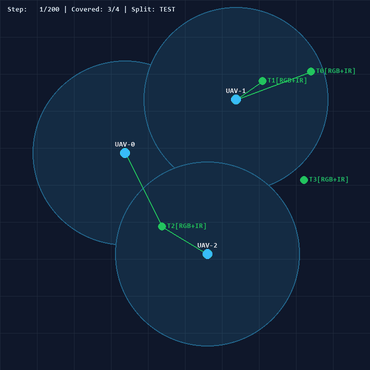

*Example simulation visualization, if the GIF is present in `assets/`. Drone positions and target positions in this animation belong to the custom simulator; they are not flight paths reconstructed in a shared real-world coordinate system.*

</div>

---

## 📌 Project at a glance

This project explores whether **Multi-Agent Proximal Policy Optimization (MAPPO)** can help multiple simulated monitoring drones coordinate target coverage while reducing collisions and redundant tracking.

The pipeline uses the **annotations** from the Anti-UAV-RGBT dataset to derive target-motion profiles and RGB/infrared (IR) visibility signals. Those profiles are replayed inside a separate, custom 2D simulation. MAPPO then learns a policy for the simulated agents.

> **Important scope clarification:** this is a dataset-driven reinforcement-learning simulation. It is **not** an end-to-end vision-based tracking system, does not run a detector on video frames during RL training, and does not establish real-world drone performance. The dataset supplies image-space motion and visibility information—not calibrated world coordinates. Unless a camera-calibration/world-coordinate pipeline is added, arena distances and speed values should be interpreted as **simulation units or nominal model parameters**, not measured physical quantities.

### What the project does

- Processes paired RGB and thermal-IR annotation JSON files.
- Derives normalized image-space motion profiles and sensor-visibility masks.
- Builds a custom 2D environment with 3 monitoring agents and 4 moving targets.
- Trains a shared actor with a centralized critic using MAPPO / centralized training and decentralized execution (CTDE).
- Compares the learned policy with random and nearest-target heuristic baselines.
- Produces training curves, benchmark charts, trajectory plots and episode visualizations.

### What it does not currently do

- Decode raw RGB/IR video frames in the RL loop.
- Train or deploy an object detector or visual tracker.
- Reconstruct calibrated 3D positions or verified real-world velocities.
- Simulate full aircraft dynamics, altitude, wind, battery use, communication delays or real sensor geometry.
- Demonstrate flight-ready or safety-certified behavior.

---

## 📚 Table of contents

1. [Motivation](#-motivation)
2. [System overview](#-system-overview)
3. [Dataset and its role](#-dataset-and-its-role)
4. [Data-processing pipeline](#-data-processing-pipeline)
5. [Simulation environment](#-simulation-environment)
6. [MAPPO architecture](#-mappo-architecture)
7. [Reward design](#-reward-design)
8. [Training workflow](#-training-workflow)
9. [Reported results](#-reported-results)
10. [Visualizations](#-visualizations)
11. [Repository structure](#-repository-structure)
12. [Setup and usage](#-setup-and-usage)
13. [Configuration and hyperparameters](#-configuration-and-hyperparameters)

---

## 🎯 Motivation

Coordinating multiple agents around several moving targets is a useful test problem for cooperative reinforcement learning. A simple nearest-target policy can send multiple agents toward the same target, create redundant coverage and cause collisions. A learned policy may discover a better trade-off between coverage, coordination and separation.

This repository studies that question in a controlled simulator using motion and visibility patterns derived from an existing RGB-Thermal UAV-tracking benchmark.

### Research question

**Can a MAPPO policy improve multi-target coverage while reducing inter-agent collisions compared with simple baseline policies in a dataset-driven 2D simulation?**

The experiment is designed to evaluate that question in simulation. It should not be interpreted as proof that the learned policy would work on physical drones without additional perception, localization, dynamics and safety validation.

---

## 🧭 System overview

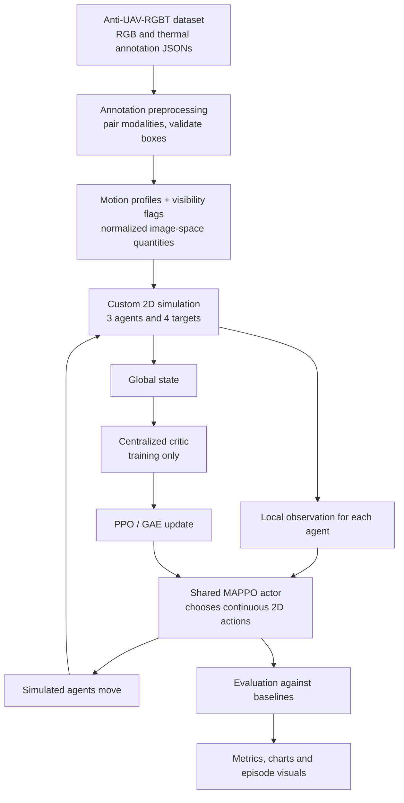

### The three main layers

| Layer | Purpose | Output |
|---|---|---|
| Data processing | Converts dataset annotations into compact profiles | Motion profiles, visibility masks and attributes |
| Simulation and learning | Runs target/agent interactions and trains MAPPO | A learned policy checkpoint |
| Evaluation | Compares policies under the simulator's test protocol | Coverage, tracking-error, overlap and collision metrics |

---

## 📦 Dataset and its role

This project uses the **Anti-UAV-RGBT** benchmark. The official project and dataset information are available from the [Anti-UAV website](https://anti-uav.github.io/) and the [official code repository](https://github.com/ZhaoJ9014/Anti-UAV).

The benchmark contains visible-spectrum (RGB) and thermal-infrared video sequences with per-frame target annotations. The exact sequence count, split definitions and annotation format depend on the particular dataset release downloaded; check the files supplied with your copy before assuming the counts below apply.

### What this project consumes

| Input | How it is used |
|---|---|
| `visible.json` | RGB bounding boxes and target-existence/visibility annotations |
| `infrared.json` | Thermal-IR bounding boxes and target-existence/visibility annotations |
| Dataset split folders | Keep training, validation and test sequences separated |
| Challenge attributes, if provided | Optional grouping for analysis by conditions such as occlusion or low illumination |

**The RL pipeline uses annotation files rather than raw video pixels.** The video files are not decoded by the trajectory-extraction step described here.

### Dataset-to-simulation boundary

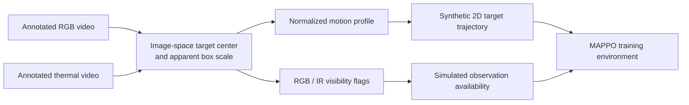

The extracted profiles preserve selected temporal patterns from annotated recordings. The simulator then creates its own target positions and agent interactions.

**Interpretation note:** the two camera modalities do not, by themselves, provide a calibrated 2D ground-plane position or metric 3D trajectory. Image-space displacement and apparent box size can be useful motion proxies, but should not be described as measured physical velocity without a validated calibration model.

### Expected dataset layout

The following is an example layout. Adapt it to the actual structure of your downloaded release.

```text
project-root/
├── train/
│   └── <sequence>/
│       ├── visible.json
│       └── infrared.json
├── val/
│   └── <sequence>/
│       ├── visible.json
│       └── infrared.json
├── test/
│   └── <sequence>/
│       ├── visible.json
│       └── infrared.json
└── label_new/                  # Optional; if included in the release
    ├── train.json
    ├── val.json
    └── test.json
```

Do not upload the dataset to this repository unless its license and distribution terms explicitly allow redistribution.

---

## 🧹 Data-processing pipeline

The extraction script, `extract_rgbt_paired.py`, reads the RGB and IR annotation files and generates compact NumPy trajectory records.

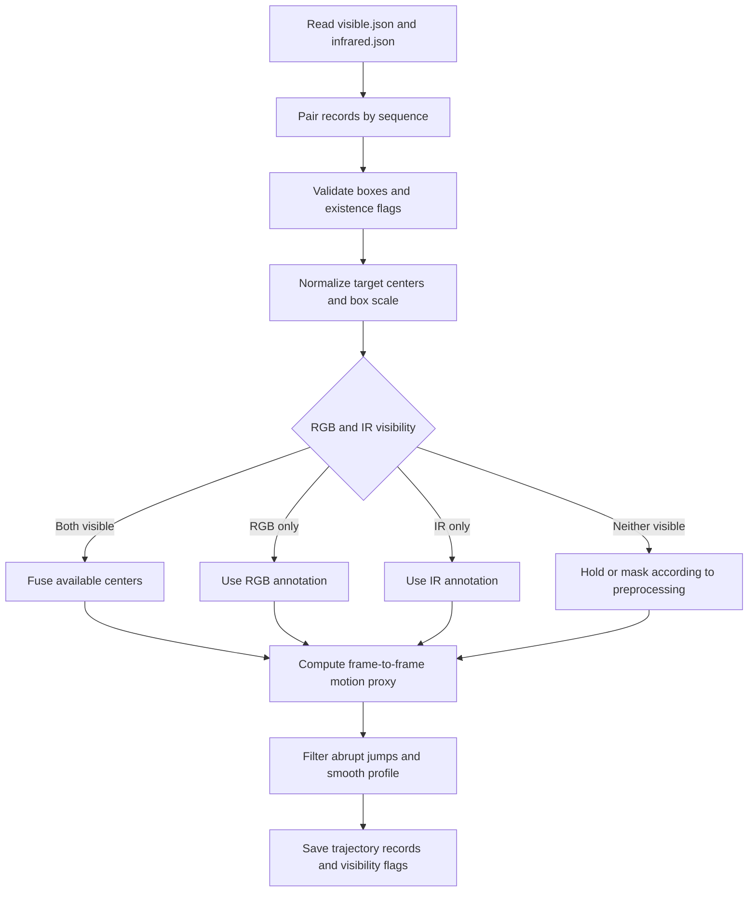

### Processing steps

1. Read the RGB and thermal annotation JSON files.
2. Pair the annotations from the same sequence and align available frame indices.
3. Validate bounding boxes and target-existence flags.
4. Normalize target centers and apparent box scale relative to image dimensions.
5. Select or fuse available RGB/IR annotation values according to the implemented preprocessing rules.
6. Compute frame-to-frame image-space displacement.
7. Apply the configured jump rejection and smoothing operations.
8. Save motion profiles, visibility flags and optional sequence attributes as compact `.npy` files.

Exact fusion weights, thresholds, smoothing coefficients and fallback behavior are implementation-specific. Refer to `extract_rgbt_paired.py` for the values used by your current checkout.

### Generated files

```text
data/
└── processed_rgbt/
    ├── train_rgbt_trajectories.npy
    ├── val_rgbt_trajectories.npy
    └── test_rgbt_trajectories.npy
```

These files are generated locally and may be excluded from Git because they are reproducible from the dataset annotations.

### Split hygiene

- Train the policy using training profiles only.
- Use validation profiles to select checkpoints and tune settings.
- Use the test split for final reporting, not repeated model selection.
- Check that no source sequence or overlapping trajectory window leaks between splits.
- Save seeds and evaluation configuration so results can be reproduced.

---

## 🌍 Simulation environment

The project defines a custom 2D multi-agent environment in `envs/uav_rgbt_env.py`. It models agents that move through a bounded arena and attempt to cover multiple moving targets.

| Property | Current project configuration |
|---|---|
| Environment | Custom 2D simulation |
| Monitoring agents | 3 |
| Moving targets | 4 |
| Episode horizon | 200 steps (configured default; verify current code) |
| Action | Continuous 2D movement command |
| Observation | Local observation for each agent |
| Learning setup | Cooperative multi-agent RL |
| Target motion | Profiles derived from dataset annotations, with configured simulation variation during training |
| Sensor availability | Simulated RGB/IR visibility cues based on annotation-derived flags |
| Rendering | Pygame visualization, if enabled |

Values above describe the simulator configuration, not verified real aircraft specifications.

### Observation and action flow

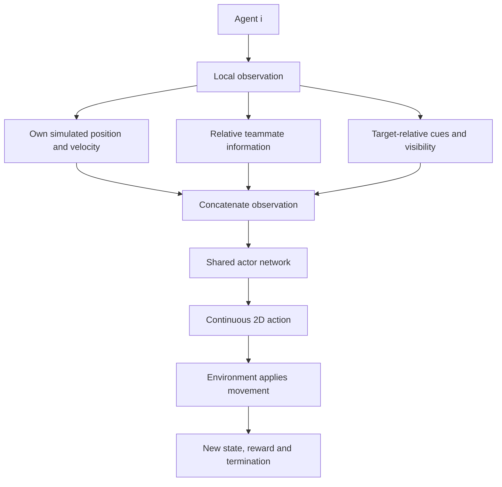

### Sensor-model interpretation

The environment uses simplified sensor logic to decide what target information is available to each agent. Annotation-derived RGB/IR visibility is a **temporal visibility proxy**. It does not automatically model whether a target is visible from each simulated agent's distinct position, angle, altitude or camera orientation.

For that reason, this environment is best treated as a controlled abstraction for coordination experiments—not a high-fidelity sensor simulator.

---

## 🧠 MAPPO architecture

MAPPO stands for **Multi-Agent Proximal Policy Optimization**. This project uses the CTDE paradigm: **centralized training and decentralized execution**.

- **Shared actor:** maps each agent's local observation to an action. The same policy parameters are shared across homogeneous agents.
- **Centralized critic:** uses global simulator state to estimate value during training.
- **PPO update:** optimizes the actor with a clipped policy objective.
- **GAE:** estimates advantages using generalized advantage estimation.
- **Decentralized execution:** the actor can select actions from local observations without requiring the critic at inference time.

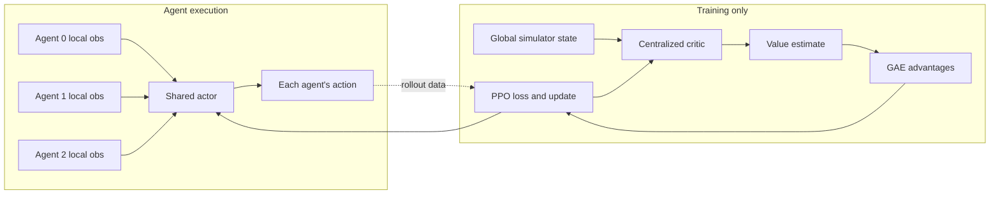

### Conceptual network diagram

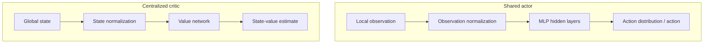

Consult `algos/networks.py` and `algos/mappo_agent.py` for the exact dimensions, activations, distribution handling, clipping and optimization logic in the current code. Keeping the README synchronized with the implementation is important as the project evolves.

---

## 🎯 Reward design

The reward function is intended to encourage target coverage while discouraging unsafe proximity and inefficient duplication of effort.

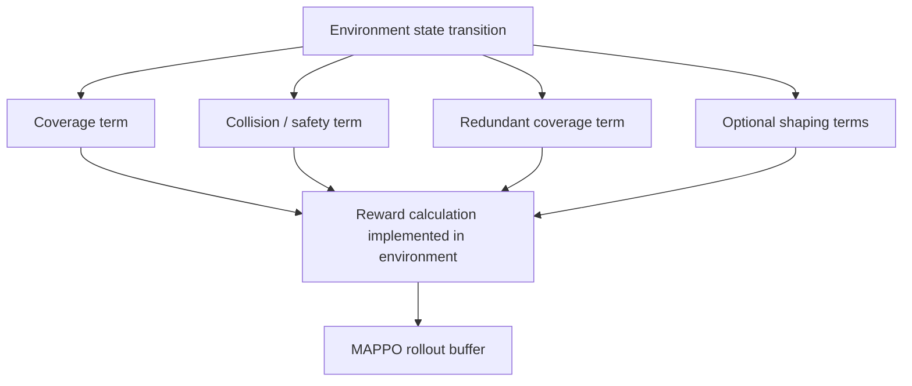

| Reward concept | Intended behavior |
|---|---|
| Target coverage | Encourage at least one agent to cover each target |
| Collision penalty | Discourage agents from entering the configured collision threshold |
| Redundant coverage penalty | Discourage too many agents from following the same target unnecessarily |
| Proximity penalty | Encourage separation before a collision occurs |
| Optional assignment/shaping terms | Encourage useful spatial distribution or task allocation, if enabled |

**Implementation note:** the exact coefficients and whether the reward is purely shared or combines team and individual shaping must match `envs/uav_rgbt_env.py`. Check the code before quoting numerical reward weights in a report. The reward terms describe the intended objective, not a guarantee that the learned policy will satisfy it.

---

## 🏋️ Training workflow

The training script is `train.py`. At a high level, it collects simulated experience, estimates advantages, updates the actor and critic, and periodically evaluates the current policy.

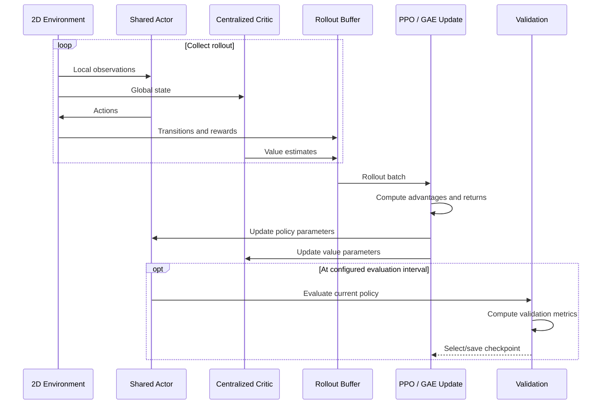

### Typical workflow

1. Prepare the dataset annotations and generate processed trajectory files.
2. Initialize the simulation and MAPPO networks.
3. Collect rollouts from the training split.
4. Compute returns and advantages.
5. Optimize the policy and value networks.
6. Evaluate periodically on validation scenarios.
7. Save checkpoints and training history.
8. Run the final benchmark on held-out test scenarios.
9. Generate charts and visualizations.

The number of environment steps, rollout size, training duration and FPS depend on the current script, hardware, dependency versions and runtime settings. Treat timing figures as machine-specific measurements rather than guarantees.

---

## 📊 Reported results

The original project README reports the following results for 30 seeded episodes of 200 steps each on the held-out test split. **These are repository-reported results; they have not been independently reproduced as part of this README rewrite.** Re-run the evaluation script and verify the metrics JSON before treating the figures as final.

### Reported baseline comparison

| Metric | Random policy | Nearest-target heuristic | MAPPO policy |
|---|---:|---:|---:|
| Target Coverage Ratio (TCR) ↑ | 46.67% | 67.11% | **78.78%** |
| Average Tracking Error ↓ | 28.75 | **17.97** | 18.47 |
| Redundant overlaps per step ↓ | **0.46** | 2.24 | 1.03 |
| Total collisions across 30 episodes ↓ | 66 | 5,341 | **16** |
| Mean collisions per episode ↓ | 2.20 | 178.03 | **0.53** |

**Metric-unit caution:** the prior README labels tracking error and arena geometry in metres, but the dataset-derived motion profiles do not by themselves establish a calibrated physical coordinate system. Unless the implementation includes a validated calibration transform, report the error in **simulation units** rather than claiming metres.

### Coverage comparison

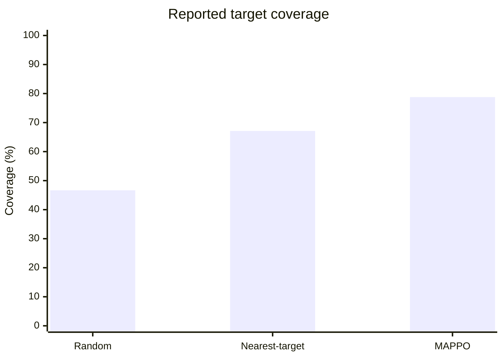

### Tracking-error comparison

Lower is better. The units should be treated as simulation units unless calibrated.

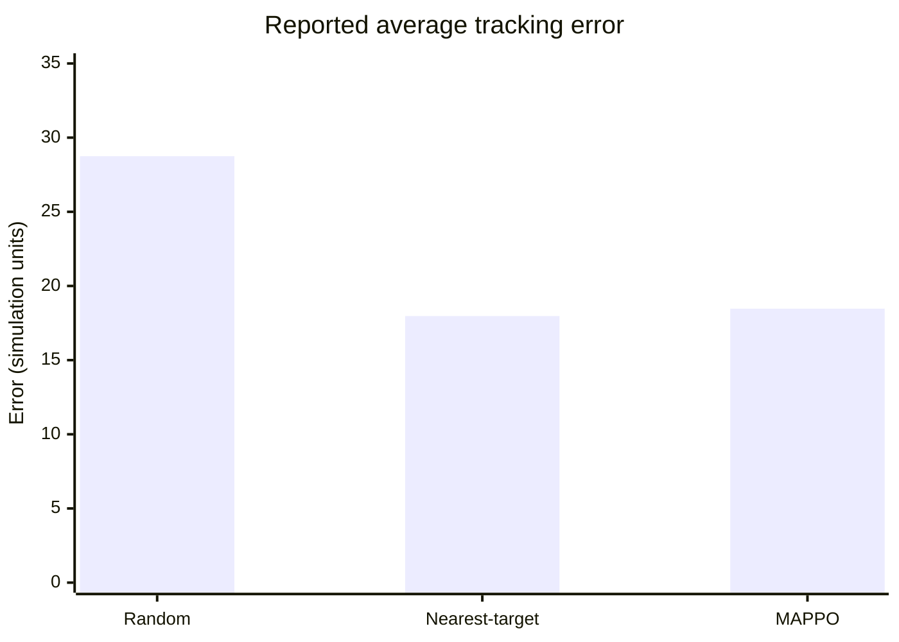

### Collision comparison

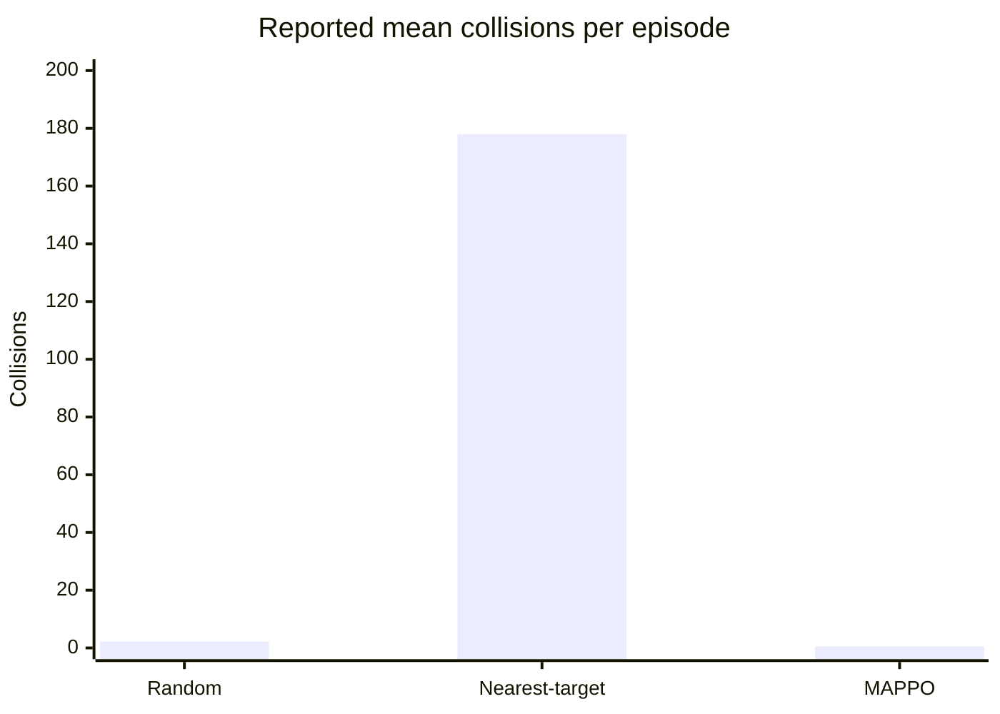

### How to interpret the reported numbers

- MAPPO reports higher target coverage than the two listed baselines.
- MAPPO reports fewer collisions than the nearest-target heuristic in the current benchmark.
- The nearest-target heuristic reports slightly lower tracking error than MAPPO, so the learned policy does not win every metric.
- The random policy's lower overlap count should not be interpreted as better coordination; overlap must be interpreted alongside coverage.
- The nearest-target heuristic is a simple baseline. Stronger comparisons should include a collision-aware heuristic and an explicit target-assignment baseline.
- Report means with standard deviations or confidence intervals across multiple training seeds, not only one trained checkpoint and one set of test episodes.

### Optional repository-generated benchmark figure

If the file exists in the repository, the following image will render on GitHub:

<div align="center">
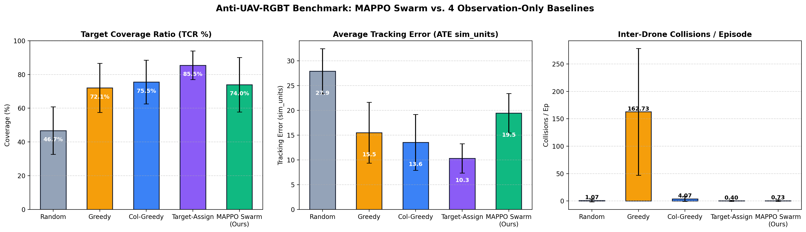
</div>

If this image does not appear, check that `assets/baseline_comparison.png` is committed and that the path and capitalization match exactly.

---

## 📈 Visualizations

### Training curves

Training curves can help show whether reward, coverage, tracking error, overlap and collision metrics change over training. They are diagnostic evidence—not, on their own, proof of generalization.

<div align="center">
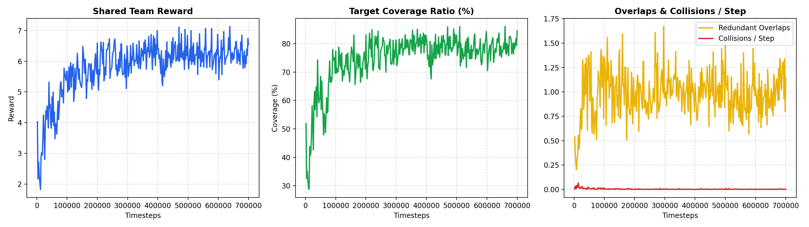
</div>

### Simulated trajectory trails

<div align="center">
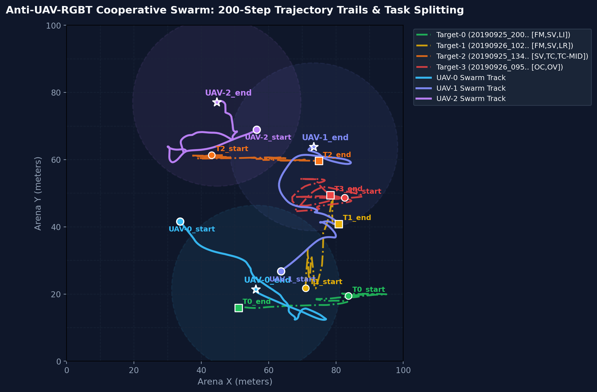
</div>

### Episode snapshots

<div align="center">
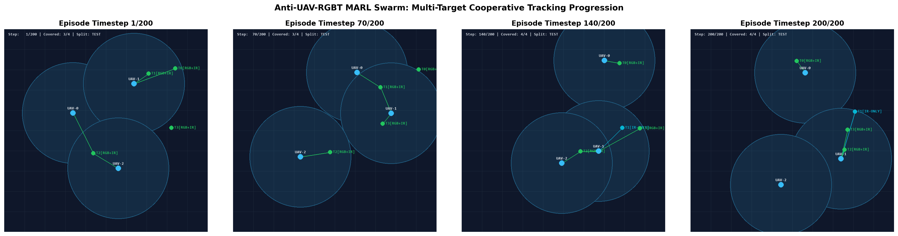
</div>

These plots visualize trajectories inside the custom simulator. They should not be described as actual flight paths or proof of real-world tracking performance.

---

## 📁 Repository structure

The following reflects the intended project organization. Some generated files may be absent from Git because datasets, checkpoints and results are commonly excluded by `.gitignore`.

```text
swarm-uav-tracking-mappo/
├── README.md
├── requirements.txt
├── .gitignore
├── extract_rgbt_paired.py       # Annotation preprocessing
├── train.py                     # MAPPO training and validation
├── evaluate_visualize.py        # Evaluation, baselines and plots
├── framecut.py                  # Optional video frame extraction utility
├── envs/
│   ├── __init__.py
│   └── uav_rgbt_env.py           # Custom 2D multi-agent environment
├── algos/
│   ├── __init__.py
│   ├── networks.py              # Actor, critic and normalization
│   └── mappo_agent.py           # PPO, GAE and optimization
├── data/
│   └── processed_rgbt/           # Generated trajectory records
├── checkpoints/                  # Saved actor/critic checkpoints
├── results/                      # Metrics, charts and episode outputs
├── assets/                       # Figures embedded in README
└── runs/                         # TensorBoard logs, if enabled
```

Raw dataset directories are expected to be supplied locally and should not be committed unless redistribution is permitted.

---

## 🚀 Setup and usage

Commands below are a starting point. Check the actual command-line arguments in your current scripts with `python train.py --help` and `python evaluate_visualize.py --help`, because defaults can change.

### 1. Clone the repository

```bash
git clone https://github.com/vVIBHORj/swarm-uav-tracking-mappo.git
cd swarm-uav-tracking-mappo
```

### 2. Create a virtual environment

**Windows PowerShell**

```powershell
py -3.10 -m venv .venv
.\.venv\Scripts\Activate.ps1
python -m pip install --upgrade pip
pip install -r requirements.txt
```

**Linux / macOS**

```bash
python3.10 -m venv .venv
source .venv/bin/activate
python -m pip install --upgrade pip
pip install -r requirements.txt
```

Install a PyTorch build compatible with your Python version and CUDA setup if the default requirements do not provide GPU support. Use the official [PyTorch installation selector](https://pytorch.org/get-started/locally/) rather than assuming one CUDA wheel works on every system.

### 3. Download and place the dataset

1. Follow the official [Anti-UAV dataset instructions](https://anti-uav.github.io/).
2. Accept any applicable dataset terms.
3. Place the annotation files under the expected train/validation/test layout.
4. Keep the raw dataset out of Git unless the license explicitly permits redistribution.

### 4. Extract trajectory profiles

```bash
python extract_rgbt_paired.py
```

Confirm that the expected output files are created under `data/processed_rgbt/`. Inspect the script's console output and verify that the number of processed sequences matches the files you supplied.

### 5. Train MAPPO

Check available arguments first:

```bash
python train.py --help
```

Example command, if these options are supported by your checkout:

```bash
python train.py --total-timesteps 700000 --rollout-steps 2000 --eval-interval 10 --batch-size 512 --lr 3e-4
```

Do not assume the example values are the current defaults. Use the help output and source code as the authoritative reference.

### 6. Monitor training

If TensorBoard logging is enabled:

```bash
tensorboard --logdir runs
```

Open the local URL printed by TensorBoard to inspect training metrics.

### 7. Evaluate and generate visualizations

Check supported options:

```bash
python evaluate_visualize.py --help
```

Example commands, if supported by the current script:

```bash
# Compare policies
python evaluate_visualize.py --compare-baselines --episodes 30

# Save a GIF
python evaluate_visualize.py --save-gif

# Launch interactive rendering
python evaluate_visualize.py --render
```

Generated metrics and visualizations should be written to the configured results directory. Verify the output files before referencing them in a report or README.

---

## ⚙️ Configuration and hyperparameters

The exact settings should be read from `train.py`, `algos/` and `envs/` in the current checkout. The values below summarize the configuration reported in the previous README and should be re-verified after code changes.

| Parameter | Previously reported value |
|---|---|
| Agents / targets | 3 / 4 |
| Local observation dimension | 39 |
| Centralized state dimension | 28 |
| Action dimension | 2 |
| Total environment steps | 700,000 |
| Rollout length | 2,000 |
| PPO epochs per update | 10 |
| Minibatch size | 512 |
| Learning rate | 3e-4 |
| Discount factor γ | 0.99 |
| GAE λ | 0.95 |
| PPO clip coefficient | 0.2 |
| Entropy coefficient | 0.01 |
| Gradient norm clipping | 0.5 |
| Actor hidden layers | Previously reported as 2 × 64 |
| Critic hidden layers | Previously reported as 2 × 128 |
| Episode length | 200 steps |
| Target/drone count | 4 / 3 |

These are documented configuration values, not guarantees of performance on every machine. Checkpoint architecture and observation dimensions must match the code used to load them.

---


### MAPPO

- Yu et al., *The Surprising Effectiveness of PPO in Cooperative Multi-Agent Games*, NeurIPS 2022.
- Paper: [arXiv:2103.01955](https://arxiv.org/abs/2103.01955)

### Frameworks

- [PyTorch](https://pytorch.org/) — neural network training.
- [PettingZoo](https://pettingzoo.farama.org/) — multi-agent environment API, if used by the environment implementation.
- [Gymnasium](https://gymnasium.farama.org/) — environment API and utilities, if used by the current implementation.
- [Pygame](https://www.pygame.org/) — simulation visualization, if enabled.

---

## 📄 Disclaimer

This repository is an experimental research and portfolio project. It is intended to study cooperative multi-agent reinforcement learning in a simulated environment. It is **not** a flight-control system, a validated real-world tracking system, or a substitute for safety engineering and real-world testing.

The dataset provides annotations from recorded sequences; the simulator creates its own 2D world and agent interactions. All performance numbers should be understood in the context of the stated simulation, baselines, split protocol and metric definitions.
