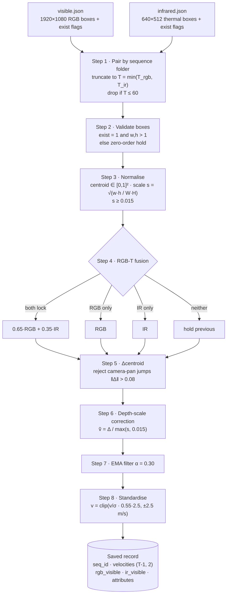
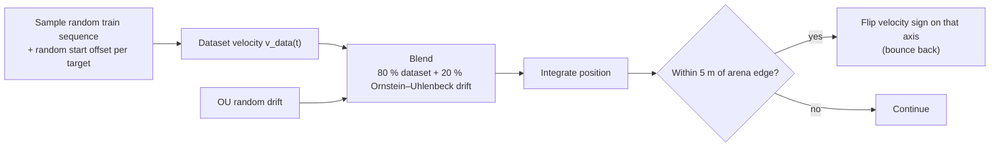
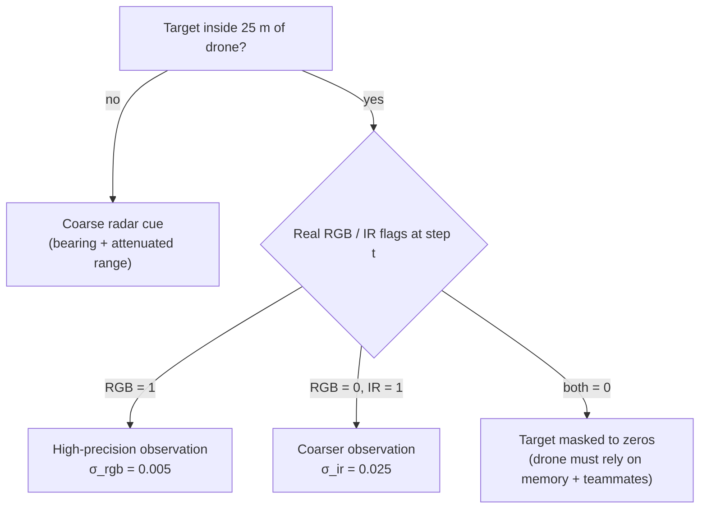
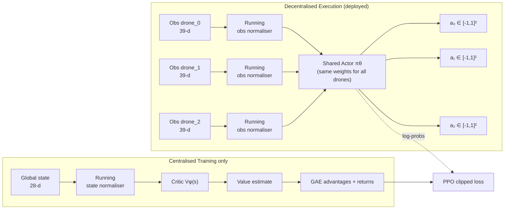
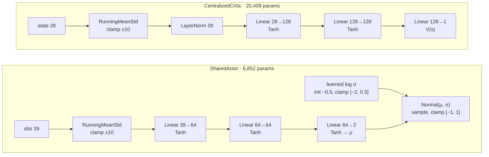
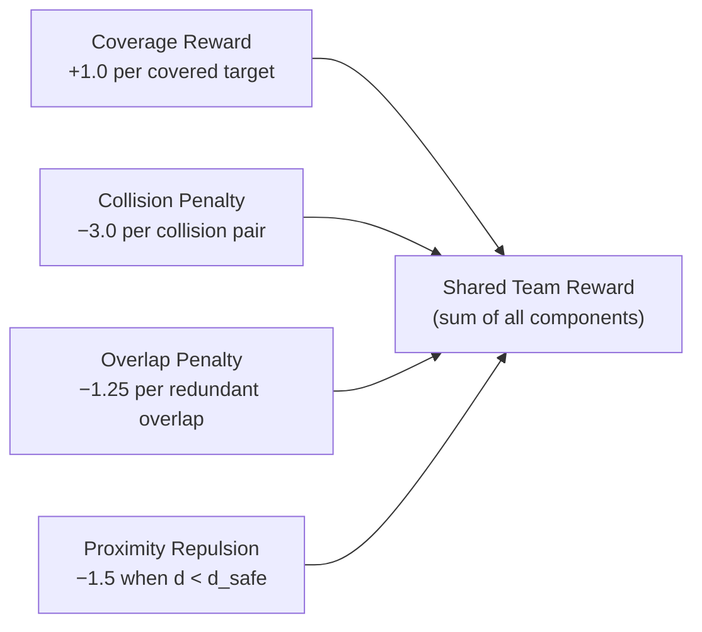
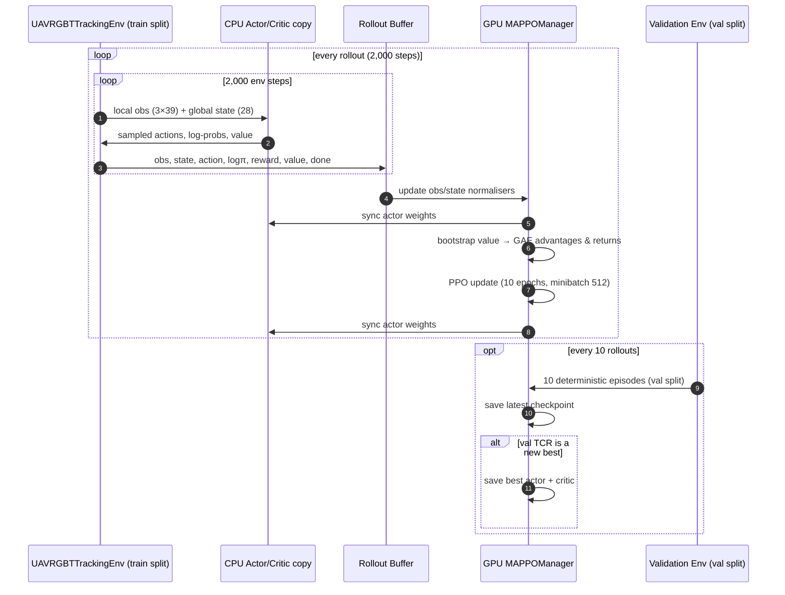

<div align="center">

# 🛸 Anti-UAV-RGBT Swarm: Multi-Agent RL for Cooperative Multi-Target Tracking

**A 3-drone swarm trained with MAPPO (CTDE) to track 4 evasive UAV targets, driven by real RGB-Thermal flight trajectories from the Anti-UAV-RGBT (Anti-UAV300) dataset.**


-f59e0b)


*A held-out test episode: 3 monitoring UAVs (blue) with 25 m sensor rings cover 4 targets (green = RGB+IR lock, cyan = IR-only lock).*

</div>

---

## 📑 Table of Contents

1. [Highlights](#-highlights)
2. [Dataset: Anti-UAV-RGBT (Anti-UAV300)](#-dataset-anti-uav-rgbt-anti-uav300)
3. [Results at a Glance](#-results-at-a-glance)
4. [System Design](#-system-design)
5. [File Overview](#-file-overview)
6. [Dataset Processing Pipeline](#-dataset-processing-pipeline)
7. [Simulation Environment](#-simulation-environment)
8. [AI Architecture (MAPPO / CTDE)](#-ai-architecture-mappo--ctde)
9. [Reward Function](#-reward-function)
10. [How the Model Is Trained](#-how-the-model-is-trained)
11. [Evaluation & Benchmarks](#-evaluation--benchmarks)
12. [Qualitative Results](#-qualitative-results)
13. [Repository Structure](#-repository-structure)
14. [Quick Start](#-quick-start)
15. [Hyperparameters](#-hyperparameters)
16. [Limitations & Future Work](#-limitations--future-work)
17. [Citation & Acknowledgements](#-citation--acknowledgements)


---

## ✨ Highlights

- **Real-world target behaviour.** Targets are not scripted: they replay motion profiles extracted from **318 real dual-camera UAV flights** (160 train / 67 val / 91 test) of the Anti-UAV-RGBT (Anti-UAV300) benchmark.
- **Realistic sensor dropouts.** Each target carries the *empirical* RGB / thermal-IR visibility masks of its source flight, so a target can vanish from one or both sensors even inside a drone's range, forcing the swarm to coordinate rather than react.
- **CTDE MAPPO.** One **shared actor** (decentralised execution from local observations) plus a **centralised critic** (global state, training only).
- **Laptop-class hardware.** Only ~10 MB of trajectory metadata is used for RL. Rollouts run on CPU, PPO updates on a 4 GB RTX 3050.
- **Strict data hygiene.** Train / validation / test follow the official dataset splits; the best checkpoint is chosen on validation and reported on the untouched test split.
- **High-throughput training.** Vectorized NumPy observations and CPU rollout inference with single-batch GPU PPO updates achieve **700–850 FPS** on the RTX 3050.

---

## 📦 Dataset: Anti-UAV-RGBT (Anti-UAV300)

This project is powered by the **Anti-UAV-RGBT** dataset (also known as **Anti-UAV300**), a large-scale multi-modal benchmark for UAV tracking.

| Property | Detail |
|---|---|
| **Full name** | Anti-UAV-RGBT (Anti-UAV300) |
| **Source** | [Anti-UAV Challenge](https://anti-uav.github.io/) — *CVPR / ICCV Workshop Series* |
| **Download** | Available from the [official Anti-UAV website](https://anti-uav.github.io/) after registration |
| **Sequences** | 318 paired RGB + Thermal-IR video recordings of real UAV flights |
| **Splits** | 160 train / 67 val / 91 test (official splits) |
| **Modalities** | Visible (RGB, 1920×1080) + Infrared (IR, 640×512) |
| **Annotations** | Per-frame bounding boxes (`gt_rect`) + visibility flags (`exist`) in `visible.json` / `infrared.json` per sequence |
| **Challenge attributes** | `label_new/` provides per-split attribute tags: FM (fast motion), SV (scale variation), OV (out of view), LI (low illumination), LR (low resolution), OC (occlusion), TC (thermal crossover: EASY / MID / HARD) |

### What we use from the dataset

For the RL pipeline, **only the JSON annotations are needed** — the raw `.mp4` video files are never decoded. The `extract_rgbt_paired.py` script reads `visible.json` + `infrared.json` from each sequence folder, pairs them, and produces lightweight velocity profiles + sensor visibility masks (~10 MB total).

### Dataset directory layout (expected)

```text
project-root/
├── train/
│   ├── 20190925_131530_1_4/
│   │   ├── visible.json       # RGB annotations
│   │   └── infrared.json      # Thermal-IR annotations
│   ├── 20190925_134501_1_1/
│   │   └── ...
│   └── ...                    # 160 sequences
├── val/
│   └── ...                    # 67 sequences
├── test/
│   └── ...                    # 91 sequences
└── label_new/
    ├── train.json             # Challenge attribute tags for train split
    ├── val.json               # Challenge attribute tags for val split
    └── test.json              # Challenge attribute tags for test split
```

---

## 📊 Results at a Glance

Evaluated on the **held-out test split**, 30 seeded episodes (seeds 5000–5029), 200 steps per episode.

| Metric | Random | Greedy Nearest-Target | **MAPPO Swarm (Ours)** |
|---|:---:|:---:|:---:|
| Target Coverage Ratio (TCR) ↑ | 46.7 % | 67.1 % | **78.8 %** |
| Avg Tracking Error (ATE, m) ↓ | 28.7 | **18.0** | 18.5 |
| Redundant Overlaps / step ↓ | **0.46** | 2.24 | 1.03 |
| Inter-drone Collisions / episode ↓ | 2.20 | 178.03 | **0.53** |

<div align="center">

</div>

**Reading the numbers**

- MAPPO covers **+11.7 pp** more targets than the greedy heuristic and **+32.1 pp** more than random.
- The greedy heuristic sends every drone to its nearest target, so drones pile onto the same target and fly into each other: **178 collisions per episode, roughly 330× more than MAPPO**.
- Greedy is marginally better on ATE (18.0 m vs 18.5 m). The learned swarm trades a little per-target precision for much broader, safer coverage. The random policy has the lowest overlap only because it rarely covers anything.

---

## 🏗️ System Design

End-to-end view: from raw dataset archive to a benchmarked swarm policy.

```mermaid
flowchart LR
    subgraph DATA["1 · Data Layer"]
        RAW["Anti-UAV-RGBT dataset<br/>train/ val/ test/ label_new/<br/>318 sequences"]
        EXTRACT["extract_rgbt_paired.py<br/>pair · fuse · de-pan · EMA"]
        NPY[("train / val / test<br/>_rgbt_trajectories.npy<br/>~10 MB")]
        RAW --> EXTRACT --> NPY
    end

    subgraph ENV["2 · Simulation Layer"]
        SIM["UAVRGBTTrackingEnv<br/>100×100 m arena<br/>3 drones · 4 targets"]
        NOISE["Sensor model<br/>RGB / IR noise + dropout masks"]
        NPY --> SIM
        SIM --> NOISE
    end

    subgraph RL["3 · Learning Layer"]
        ACTOR["Shared Actor πθ<br/>local obs → action"]
        CRITIC["Centralised Critic Vφ<br/>global state → value"]
        PPO["PPO + GAE<br/>GPU updates"]
        NOISE -- "local obs (39-d)" --> ACTOR
        SIM -- "global state (28-d)" --> CRITIC
        ACTOR -- "2-D velocity" --> SIM
        ACTOR --> PPO
        CRITIC --> PPO
    end

    subgraph OPS["4 · Evaluation Layer"]
        VAL["Validation every 10 rollouts<br/>pick best TCR checkpoint"]
        TEST["Held-out test + baselines<br/>evaluate_visualize.py"]
        VIZ["Trails · GIF · charts"]
        PPO --> VAL --> TEST --> VIZ
    end
```



---

## 📂 File Overview

A detailed breakdown of every file in the repository and what it does:

### Root-level scripts

| File | Lines | Purpose |
|---|:---:|---|
| [`extract_rgbt_paired.py`](extract_rgbt_paired.py) | 198 | **Data preprocessing.** Reads `visible.json` / `infrared.json` annotations from each sequence, pairs RGB + IR modalities, applies pan-jump rejection, depth-scale correction, EMA smoothing, and standardisation. Outputs `data/processed_rgbt/{split}_rgbt_trajectories.npy`. |
| [`train.py`](train.py) | 307 | **MAPPO training loop.** Collects vectorized rollouts on CPU, performs PPO updates on GPU, runs periodic validation on the `val` split, saves best/latest checkpoints, logs to TensorBoard, and exports `results/training_curves.png`. Supports `--resume` for fine-tuning. |
| [`evaluate_visualize.py`](evaluate_visualize.py) | 453 | **Evaluation & benchmarking suite.** Runs 30-episode test evaluation for Random / Greedy / MAPPO policies, generates per-attribute breakdown tables, bar charts (`results/baseline_comparison.png`), trajectory trail plots (`results/swarm_trajectory_trails.png`), GIF export, and live Pygame rendering. |
| [`framecut.py`](framecut.py) | 43 | **Optional utility.** Splits `.mp4` video files into per-frame JPG images using OpenCV. *Not required for the RL pipeline* — only needed for vision-based downstream work. |
| [`requirements.txt`](requirements.txt) | 15 | Python dependency specification with minimum versions. |

### `envs/` — Environment

| File | Lines | Purpose |
|---|:---:|---|
| [`envs/__init__.py`](envs/__init__.py) | — | Python package marker. |
| [`envs/uav_rgbt_env.py`](envs/uav_rgbt_env.py) | 388 | **Multi-agent 2-D tracking simulator.** PettingZoo `ParallelEnv` with 3 drone agents and 4 target UAVs. Features vectorized NumPy observation builders (`obs_dim=39`), global state for the centralised critic (`state_dim=28`), dual-tier sensor model (precision RGB lock inside 25 m, coarser IR observation, radar cues outside FOV), hybrid target dynamics (80% dataset replay + 20% OU drift in training), anti-clustering overlap penalty, proximity repulsion, Voronoi task assignment reward shaping, and a Pygame HUD renderer. |

### `algos/` — Neural Networks & RL Agent

| File | Lines | Purpose |
|---|:---:|---|
| [`algos/__init__.py`](algos/__init__.py) | — | Python package marker. |
| [`algos/networks.py`](algos/networks.py) | 91 | **Neural network architecture.** `RunningMeanStd` (Welford online normaliser), `layer_init` (orthogonal weight init), `SharedActor` (64×64 Tanh MLP with learnable clamped log-std), and `CentralizedCritic` (LayerNorm + 128×128 Tanh MLP). |
| [`algos/mappo_agent.py`](algos/mappo_agent.py) | 113 | **MAPPO training manager.** `MAPPOManager` encapsulates GAE advantage computation, clipped PPO actor/critic loss, value clipping, gradient norm clipping, learning rate annealing, and CPU↔GPU actor weight synchronisation. |

### `data/` — Processed trajectories

| File | Size | Purpose |
|---|:---:|---|
| `data/processed_rgbt/train_rgbt_trajectories.npy` | 2.3 MB | 160 train-split trajectory records (velocities, visibility masks, attributes). |
| `data/processed_rgbt/val_rgbt_trajectories.npy` | 953 KB | 67 val-split trajectory records. |
| `data/processed_rgbt/test_rgbt_trajectories.npy` | 1.3 MB | 91 test-split trajectory records. |

### `checkpoints/` — Trained model weights

| File | Size | Purpose |
|---|:---:|---|
| `checkpoints/mappo_actor_best.pt` | 31 KB | Best validation TCR actor weights (SharedActor, 6,852 params). |
| `checkpoints/mappo_critic_best.pt` | 84 KB | Best validation TCR critic weights (CentralizedCritic, 20,409 params). |
| `checkpoints/mappo_actor_latest.pt` | 31 KB | Latest training actor weights. |
| `checkpoints/mappo_critic_latest.pt` | 84 KB | Latest training critic weights. |

### `results/` — Output artifacts

| File | Purpose |
|---|---|
| `results/training_curves.png` | 3-panel publication-quality training curves (reward, TCR, overlaps & collisions). |
| `results/training_history.npz` | Raw training history arrays for custom plotting. |
| `results/baseline_comparison.png` | 4-panel bar chart comparing Random vs Greedy vs MAPPO. |
| `results/final_benchmark_metrics.json` | Full quantitative metrics including per-attribute breakdown for all 3 policies. |
| `results/swarm_trajectory_trails.png` | 2-D arena trajectory trail plot showing emergent task splitting. |
| `results/test_episode_preview.gif` | Animated GIF of a full test episode. |
| `results/test_episode_preview.png` | 4-panel static progression snapshot (steps 1, 70, 140, 200). |

### Other directories

| Directory | Purpose |
|---|---|
| `assets/` | Copies of result figures embedded in this README. |
| `runs/` | TensorBoard event logs (view with `tensorboard --logdir runs`). |
| `train/`, `val/`, `test/`, `label_new/` | Raw Anti-UAV-RGBT dataset folders (not checked into git). |

---

## 🎞️ Dataset Processing Pipeline

The raw dataset holds, per flight, two videos and two annotation files. For RL we only need the annotations, so the videos are never decoded.



### Fusion rule

| Sensor state | Fused centroid / scale | Rationale |
|---|---|---|
| RGB ✔ IR ✔ | `0.65·RGB + 0.35·IR` | RGB has the finer pixel grid. |
| RGB ✔ IR ✘ | RGB | Thermal crossover with warm background. |
| RGB ✘ IR ✔ | IR | Darkness, glare, or clutter. |
| RGB ✘ IR ✘ | previous fused value | Full occlusion. |

### Why these filters matter

- **Pan-jump rejection** removes the tripod re-centring slews that otherwise look like a target teleporting across the frame.
- **Depth-scale correction** converts "pixels moved" into a physical-speed proxy: 10 px on a tiny, distant UAV is a far longer real distance than 10 px on a close one.
- **EMA smoothing** removes 1–2 px annotation jitter.
- **Standardisation** maps the resulting profile to a nominal cruise speed of `0.55 × 2.5 = 1.375 m/s`, clipped at the 2.5 m/s target maximum.

Each record also carries the sequence's **challenge attributes** (from `label_new/{split}.json`), which are later used for the per-attribute evaluation.

---

## 🌍 Simulation Environment

| Property | Value |
|---|---|
| Arena | 100 m × 100 m, 2-D |
| Monitoring drones | 3 (agents `drone_0`, `drone_1`, `drone_2`) |
| Targets | 4, each replaying an independent real flight |
| Sensor radius | 25 m per drone |
| Episode length | 200 steps |
| Action (per drone) | 2-D continuous velocity command in `[-1, 1]` |
| Local observation | 39-d vector per drone |
| Global state (critic only) | 28-d vector |
| Reward | Shared team reward (all drones receive the same signal) |
| Target max speed | 2.5 m/s |
| Drone max speed | 4.0 m/s |
| Safety radius | 2.5 m (collision threshold) |
| Time step (dt) | 0.5 s |
| Velocity damping | 0.92 |

### Observation vector breakdown (39-d per drone)

Each drone receives a 39-dimensional local observation:

| Component | Dims | Description |
|---|:---:|---|
| Own state | 4 | Normalised position `(x, y) / arena_size` + normalised velocity `(vx, vy) / max_speed` |
| Teammate relative | 8 | For each of the 2 teammates: relative position `(Δx, Δy) / arena_size` + relative velocity `(Δvx, Δvy) / max_speed` |
| Target observations | 24 | For each of the 4 targets: 6-d vector `[dx/arena, dy/arena, dvx/max_speed, dvy/max_speed, rgb_flag, ir_flag]`. Inside 25 m: precision RGB-T lock with Gaussian noise. Outside 25 m: coarse radar cue (bearing + range). Both sensors lost: zeros. |
| Agent one-hot ID | 3 | `[1,0,0]` for drone_0, `[0,1,0]` for drone_1, `[0,0,1]` for drone_2 |
| **Total** | **39** | |

### Global state vector breakdown (28-d, critic only)

| Component | Dims | Description |
|---|:---:|---|
| All drone states | 12 | 3 drones × 4-d `(x, y, vx, vy)`, normalised |
| All target states | 16 | 4 targets × 4-d `(x, y, vx, vy)`, normalised |
| **Total** | **28** | |

### How targets move



The 20 % OU drift stops the policy from memorising fixed paths while preserving the sharp turns and accelerations of real UAVs. During **validation and test**, drift is switched off, so targets follow purely real dataset velocities.

### How the dual sensor is simulated

When a drone is within 25 m of a target, the environment consults that target's real visibility flags at the current step:



### Metrics

| Metric | Meaning |
|---|---|
| **TCR** (Target Coverage Ratio) | Fraction of targets within the 25 m sensor radius of at least one drone. |
| **ATE** (Average Tracking Error) | Mean tracking error in metres. |
| **Overlap** | Redundant coverage per step (several drones assigned to the same target). |
| **Collisions** | Inter-drone collisions (distance < 2.5 m safety radius). |

---

## 🧠 AI Architecture (MAPPO / CTDE)

The policy follows **Centralised Training, Decentralised Execution (CTDE)**. Each drone acts using only its own local observation; a centralised critic that sees the whole state is used only to compute better learning signals during training and is discarded at deployment.



### Design choices

| Choice | Why |
|---|---|
| **Parameter sharing** (one actor for all 3 drones) | Drones are homogeneous; triples the data per update and gives a model that generalises to any drone slot. |
| **Continuous 2-D action** | Direct velocity control. Gaussian policy with a learned, state-independent std during training; the **deterministic mean** action at evaluation. |
| **Centralised critic on global state** | Lower-variance value estimates under partial observability; not needed at inference. |
| **One team value per step** | The critic scores the global state once per step; the resulting advantage is shared by all 3 drones. |
| **Shared team reward** | Aligns all agents on swarm-level coverage; coordination (task splitting) emerges instead of being scripted. |
| **Running mean/std normalisers** | Stable learning across observation and state scales; inputs are clamped to ±10σ and statistics are updated once per rollout. |
| **CPU actor copy for rollouts** | Avoids per-step CUDA launch latency; the CPU mirror is synced from the GPU after every update. |

### Network details



| | **SharedActor** (policy πθ) | **CentralizedCritic** (value Vφ) |
|---|---|---|
| Input | 39-d local observation | 28-d global state |
| Normalisation | `RunningMeanStd` (online mean/var, clamp ±10) | `RunningMeanStd`, then `LayerNorm` |
| Hidden layers | 2 × 64, Tanh | 2 × 128, Tanh |
| Output | 2-d mean (Tanh, range [-1, 1]) | scalar state value |
| Action distribution | Diagonal Gaussian; learned log-std parameter (init -0.5, clamped to [-2, 0.5]) | n/a |
| Init | Orthogonal, gain √2 (output layer 0.01) | Orthogonal, gain √2 (output layer 1.0) |
| Trainable params | 6,852 | 20,409 |
| Used at deployment | ✅ | ❌ (training only) |

The actor is deliberately tiny (≈ 7k parameters), so it runs in real time on very modest onboard compute.

---

## 🎯 Reward Function

The reward signal is computed per step and **shared equally** by all 3 drones. It has four components:



| Component | Formula | Purpose |
|---|---|---|
| **Coverage** | `+1.0` for each target within 25 m of ≥ 1 drone | Primary signal: encourage tracking |
| **Collision** | `−3.0` for each pair of drones within 2.5 m of each other | Safety: avoid inter-drone crashes |
| **Overlap** | `−1.25` for each redundant drone covering an already-covered target | Efficiency: discourage clustering |
| **Proximity repulsion** | `−1.5` when a drone-drone distance is near `d_safe` | Smoothly penalise close approaches before collision |

Additionally, **Voronoi task assignment shaping** gives a small bonus when each drone tracks targets in its own spatial partition, encouraging emergent task splitting rather than all drones chasing the same target.

---

## 🏋️ How the Model Is Trained

### Training loop



### Step by step

1. **Reset** the environment. Each of the 4 targets samples a random `train` sequence and start offset.
2. **Collect a rollout** of 2,000 steps on CPU. Every step stacks the 3 local observations, samples actions from the shared actor, and records the shared reward and critic value.
3. **Normalise.** Update running statistics for observations and global states once, on the GPU, then sync the CPU actor.
4. **Estimate advantages** with GAE, bootstrapping from the critic's value of the last state.
5. **PPO update** on the GPU: 10 epochs over the rollout (6,000 samples = 2,000 steps × 3 drones) in minibatches of 512, i.e. about 12 minibatches × 10 epochs ≈ 120 gradient steps per rollout. Details below.
6. **Validate** every 10 rollouts on the `val` split with deterministic actions and no synthetic drift. Save `*_latest.pt` every time and `*_best.pt` whenever validation TCR hits a new peak.
7. **Log** reward, TCR, ATE, overlap, collisions, FPS, actor loss, critic loss and entropy to TensorBoard; at the end, export `results/training_history.npz` and `results/training_curves.png`.
8. **Test** once, at the end, with `evaluate_visualize.py` on the untouched `test` split.

### The PPO objective (as implemented in `MAPPOManager`)

| Component | Implementation |
|---|---|
| Advantage estimation | GAE with **γ = 0.99, λ = 0.95**, bootstrapped from the critic on the final state; advantages are normalised per batch |
| Policy loss | PPO clipped surrogate, `clip = 0.2`, minus an **entropy bonus of 0.01** |
| Value loss | `0.5 · max((V − R)², (V_clipped − R)²)` with value clipping at the same 0.2 |
| Optimisers | Two separate **Adam** optimisers (actor, critic), `eps = 1e-5` |
| Gradient clipping | Global norm **0.5** for both networks |
| Learning-rate schedule | Linear decay from `3e-4` down to a floor of 10 % (`lr · max(0.1, 1 − 0.9 · progress)`) |
| Parallel structure | Rollouts on a CPU mirror of the networks; updates on the GPU; mirror re-synced after every update |

### Training curves

<div align="center">

</div>

Training run: **700,000 environment steps** (350 rollouts of 2,000 steps).

| Quantity | First 10 rollouts | Last 50 rollouts | Best / note |
|---|:---:|:---:|:---:|
| Shared team reward | 2.74 | 6.25 | peak 7.13 |
| Target Coverage Ratio | 38.5 % | 78.8 % | peak 86.1 % |
| Avg Tracking Error (m) | 33.2 | 17.8 | min 15.7 |
| Collisions / step | 0.026 | 0.002 | ≈ 0 after ~100k steps |
| Redundant overlaps / step | 0.42 | 1.00 | rises as coverage rises |

**What the curves show**

- **Collisions vanish early** (the red line collapses within the first ~100k steps): the swarm learns safe separation before it learns good coverage.
- **Coverage climbs in two phases**: a fast rise to ~75 % by ~100k steps, then slow refinement towards ~80 %.
- **Overlap increases with coverage.** With only 3 drones and 4 targets, some doubling-up is unavoidable when the drones sit between targets.
- Training TCR over the last 50 rollouts (78.8 %) matches the held-out test TCR (78.8 %), so there is no sign of overfitting to the training flights.

---

## 🔬 Evaluation & Benchmarks

Three policies are compared on identical seeded test episodes:

| Policy | Description |
|---|---|
| **Random** | Uniform random velocity in `[-1, 1]²` for each drone. |
| **Greedy Heuristic** | Every drone flies straight at its own nearest target; no coordination. |
| **MAPPO Swarm (ours)** | Trained shared actor, deterministic actions. |

### Full benchmark results

All metrics from `results/final_benchmark_metrics.json`, 30 episodes on held-out test split:

| Metric | Random | Greedy | **MAPPO** |
|---|:---:|:---:|:---:|
| Mean TCR ↑ | 46.67 % | 67.11 % | **78.78 %** |
| Mean ATE (m) ↓ | 28.75 | **17.97** | 18.47 |
| Mean Overlap / step ↓ | **0.46** | 2.24 | 1.03 |
| Total Collisions (30 ep) | 66 | 5,341 | **16** |
| Mean Collisions / episode ↓ | 2.20 | 178.03 | **0.53** |

### Coverage by dataset challenge attribute

Because every target carries the attribute tags of its source flight, coverage can be broken down by difficulty type.

<details>
<summary><b>📋 Full per-attribute table (TCR %)</b></summary>

| Tag | Description | Random | Greedy | **MAPPO** | Δ vs Greedy |
|---|---|:---:|:---:|:---:|:---:|
| **FM** | Fast Motion | 44.8 % | 64.5 % | **81.7 %** | +17.2 pp |
| **LI** | Low Illumination | 40.0 % | 55.5 % | **82.9 %** | +27.4 pp |
| **LR** | Low Resolution | 43.2 % | 60.8 % | **83.6 %** | +22.8 pp |
| **OC** | Occlusion | 46.8 % | 66.2 % | **79.5 %** | +13.3 pp |
| **OV** | Out of View | 45.8 % | 70.7 % | **86.2 %** | +15.5 pp |
| **SV** | Scale Variation | 47.6 % | 69.3 % | **84.6 %** | +15.3 pp |
| **TC** | Thermal Crossover (all) | 48.2 % | 71.3 % | **79.7 %** | +8.4 pp |
| **TC-EASY** | Thermal Crossover (easy) | 50.8 % | **78.3 %** | 78.7 % | +0.4 pp |
| **TC-MID** | Thermal Crossover (mid) | 45.9 % | 67.3 % | **78.8 %** | +11.5 pp |
| **TC-HARD** | Thermal Crossover (hard) | 49.6 % | 70.9 % | **83.0 %** | +12.1 pp |

*Tag codes come from the dataset's `label_new/` annotations.*

</details>

**Takeaways**

- MAPPO wins on every tag and is **remarkably flat (≈ 79–86 %)** across conditions, whereas the greedy heuristic swings from 55 % to 78 %.
- The biggest gains are on the hardest sensing conditions: **low illumination (+27 pp)**, **low resolution (+23 pp)** and **fast motion (+17 pp)**.
- Only on `TC-EASY` does greedy come close (78.3 % vs 78.7 %), as expected when targets are easy to follow.

---

## 🖼️ Qualitative Results

### Test episode preview

A 200-step test episode animated as a GIF. Drones (blue) with 25 m sensor rings autonomously track 4 targets, demonstrating learned coverage and task splitting.

<div align="center">

</div>

### Trajectory trails and emergent task splitting

<div align="center">

</div>

Solid lines are drone tracks and dash-dot lines are target tracks (circles mark starts, squares and stars mark ends; the translucent discs are the final 25 m sensor footprints). Each drone settles into its own region of the arena (UAV-0 south, UAV-1 centre-east, UAV-2 northwest), which is the cooperative task splitting that the shared reward encourages.

---

## 📁 Repository Structure

```text
.
├── Readme.md                         ← you are here
├── requirements.txt                  # Python dependencies
├── .gitignore                        # Git exclusions for datasets, caches, checkpoints
│
├── extract_rgbt_paired.py            # Dataset annotations → trajectory .npy files
├── train.py                          # MAPPO training + validation checkpointing
├── evaluate_visualize.py             # Test eval, baselines, trails, GIF
├── framecut.py                       # (optional) mp4 → per-frame jpg
│
├── envs/
│   ├── __init__.py
│   └── uav_rgbt_env.py              # UAVRGBTTrackingEnv (PettingZoo ParallelEnv)
│
├── algos/
│   ├── __init__.py
│   ├── networks.py                   # SharedActor, CentralizedCritic, RunningMeanStd
│   └── mappo_agent.py                # MAPPOManager (PPO, GAE, LR anneal)
│
├── data/
│   └── processed_rgbt/               # Generated by extract_rgbt_paired.py
│       ├── train_rgbt_trajectories.npy
│       ├── val_rgbt_trajectories.npy
│       └── test_rgbt_trajectories.npy
│
├── assets/                           # Figures embedded in this README
│   ├── baseline_comparison.png
│   ├── swarm_trajectory_trails.png
│   ├── training_curves.png
│   ├── test_episode_preview.gif
│   └── test_episode_preview.png
│
├── checkpoints/                      # Trained model weights (git-ignored)
│   ├── mappo_actor_best.pt
│   ├── mappo_critic_best.pt
│   ├── mappo_actor_latest.pt
│   └── mappo_critic_latest.pt
│
├── results/                          # Training & evaluation outputs (git-ignored)
│   ├── training_curves.png
│   ├── training_history.npz
│   ├── baseline_comparison.png
│   ├── final_benchmark_metrics.json
│   ├── swarm_trajectory_trails.png
│   ├── test_episode_preview.gif
│   └── test_episode_preview.png
│
├── runs/                             # TensorBoard logs (git-ignored)
│
└── [Dataset folders — git-ignored]
    ├── train/                        # 160 training sequences
    ├── val/                          # 67 validation sequences
    ├── test/                         # 91 test sequences
    └── label_new/                    # Challenge attribute annotations
```

---

## 🚀 Quick Start

### 1. Clone & Install

```bash
git clone https://github.com/vVIBHORj/swarm-uav-tracking-mappo.git
cd Anti-UAV-RGBT-Swarm

# Install dependencies
pip install -r requirements.txt

# For CUDA GPU support (RTX 3050 / cu124):
pip install --force-reinstall torch torchvision --index-url https://download.pytorch.org/whl/cu124
```

### 2. Download & prepare the dataset

1. Download the **Anti-UAV-RGBT (Anti-UAV300)** dataset from the [official website](https://anti-uav.github.io/).
2. Unpack the `train/`, `val/`, `test/` folders and the `label_new/` directory into the project root.
3. Run the extractor:

```bash
python extract_rgbt_paired.py
```

This writes `data/processed_rgbt/{train,val,test}_rgbt_trajectories.npy` and prints the empirical sensor dropout rates for RGB, thermal IR, and the fused RGB-T stream.

### 3. Train

```bash
# Full training from scratch (700k steps, ~15 min on RTX 3050)
python train.py --total-timesteps 700000 --rollout-steps 2000 --eval-interval 10 --batch-size 512 --lr 3e-4

# Fine-tune from best checkpoint with lower LR
python train.py --resume --total-timesteps 300000 --lr 1e-4
```

Monitor with TensorBoard:

```bash
tensorboard --logdir runs
```

### 4. Evaluate

```bash
# Held-out test split summary (MAPPO only)
python evaluate_visualize.py --episodes 20

# Full Random vs Greedy vs MAPPO comparison, JSON + charts + trails
python evaluate_visualize.py --compare-baselines --episodes 30

# Episode GIF + 4-panel progression
python evaluate_visualize.py --save-gif

# Live interactive Pygame visualiser
python evaluate_visualize.py --render
```

Outputs are written to `results/`.

### CLI reference

<details>
<summary><b>train.py arguments</b></summary>

| Argument | Default | Description |
|---|---|---|
| `--total-timesteps` | 400,000 | Total environment steps to run |
| `--rollout-steps` | 2,000 | Steps per rollout buffer |
| `--eval-interval` | 10 | Evaluation interval (in rollouts) |
| `--batch-size` | 512 | PPO minibatch size |
| `--lr` | 3e-4 | Learning rate |
| `--resume` | `False` | Resume from best checkpoint and append history |

</details>

<details>
<summary><b>evaluate_visualize.py arguments</b></summary>

| Argument | Default | Description |
|---|---|---|
| `--checkpoint` | `checkpoints/mappo_actor_best.pt` | Path to actor checkpoint |
| `--episodes` | 30 | Number of test episodes |
| `--compare-baselines` | `False` | Run full 3-policy baseline comparison |
| `--render` | `False` | Launch live Pygame visualiser |
| `--save-gif` | `False` | Record and save episode preview GIF/PNG |

</details>

---

## ⚙️ Hyperparameters

| Parameter | Value |
|---|---|
| Drones / targets | 3 / 4 |
| Observation / state / action dims | 39 / 28 / 2 |
| Total training steps | 700,000 |
| Rollout length | 2,000 steps |
| PPO epochs per rollout | 10 |
| Minibatch size | 512 |
| Learning rate | 3e-4, linearly annealed to 10 % floor |
| Discount γ / GAE λ | 0.99 / 0.95 |
| PPO clip / entropy coef. / grad-clip | 0.2 / 0.01 / 0.5 |
| Optimiser | Adam (eps 1e-5), separate for actor and critic |
| Actor / critic hidden size | 2 × 64 / 2 × 128 (Tanh) |
| Parameters (actor / critic) | 6,852 / 20,409 |
| Validation | every 10 rollouts × 10 deterministic episodes |
| Checkpoint rule | best validation TCR |
| Sensor radius | 25 m |
| Episode length | 200 steps |
| Target dataset/drift blend | 80 % / 20 % |
| RGB / IR observation noise σ | 0.005 / 0.025 |
| Target speed cap | 2.5 m/s |
| Drone speed cap | 4.0 m/s |
| Collision safety radius | 2.5 m |
| Hardware | RTX 3050 Laptop (4 GB VRAM), 16 GB RAM, Windows 11 |

---

## ⚠️ Limitations & Future Work

- **2-D abstraction.** Real altitude, camera geometry and drone dynamics are not modelled; targets inherit only the motion *profile* of the real flights, not their absolute position.
- **Fixed team size.** 3 drones and 4 targets; observation size is tied to this configuration.
- **ATE not improved.** The learned policy matches rather than beats the greedy heuristic on tracking error. A reward term for tracking precision, or per-target assignment, is a natural next step.
- **Redundant coverage.** Overlap (≈ 1.0 per step) leaves room for explicit task-assignment or communication mechanisms.
- **Ideas:** variable swarm size, recurrent or attention-based policies, 3-D dynamics, communication-aware training, and sim-to-real transfer with actual RGB-T detection in the loop.

---

## 🙏 Citation & Acknowledgements

### Dataset

This project uses the **Anti-UAV-RGBT (Anti-UAV300)** dataset. If you use this dataset, please cite the original authors:

```bibtex
@inproceedings{zhao2022anti,
  title={Anti-UAV: A Large-Scale Benchmark for Vision-Based UAV Tracking},
  author={Zhao, Jianqi and Zhang, Jiaqi and Li, Dong and Wang, Dong},
  booktitle={IEEE Transactions on Multimedia},
  year={2022}
}
```

### Algorithm

The MAPPO algorithm used in this project is based on:

```bibtex
@article{yu2022surprising,
  title={The Surprising Effectiveness of PPO in Cooperative Multi-Agent Games},
  author={Yu, Chao and Velu, Akash and Vinitsky, Eugene and Gao, Jiaxuan and Wang, Yu and Bayen, Alexandre and Wu, Yi},
  journal={Advances in Neural Information Processing Systems},
  volume={35},
  year={2022}
}
```

### Frameworks

- **[PettingZoo](https://pettingzoo.farama.org/)** for the multi-agent environment API.
- **[PyTorch](https://pytorch.org/)** for neural network training and inference.
- **[Pygame](https://www.pygame.org/)** for interactive visualisation.

---


